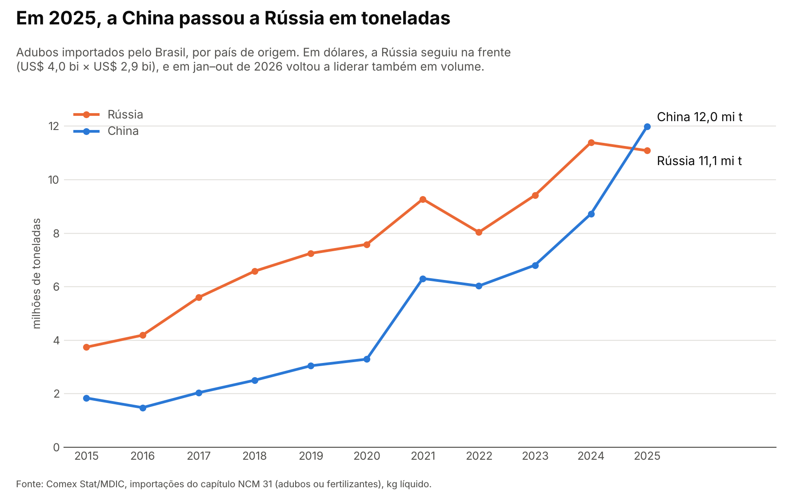

# O agro brasileiro depende de um navio

**Em 2025, a China passou a Rússia como maior fornecedora de adubo do Brasil, mas só se você contar em toneladas.**

*Gráfico: importações brasileiras de adubos (capítulo 31 da NCM) da China e da Rússia, em milhões de toneladas, 2015–2025. Fonte: Comex Stat/MDIC.*

---

## O que está acontecendo

Toda safra de soja, milho ou café começa com adubo, e a maior parte dele chega de navio. Segundo o Ministério da Agricultura, **85% do fertilizante consumido no Brasil é importado**. Em 2025, o país comprou lá fora **45,5 milhões de toneladas** de adubos, **mais que o dobro** (+130%) das 19,8 milhões de toneladas de 2015. A conta foi de **US$ 15,5 bilhões FOB**. FOB é o valor da mercadoria no porto de embarque, sem frete nem seguro.

Por anos, a Rússia foi a maior vendedora. Em 2025 a China passou na frente em peso: foram **12,0 milhões de toneladas** chinesas contra **11,1 milhões** russas. Isso dá 26,3% e 24,4% de tudo o que o Brasil importou, respectivamente. Em dez anos, o volume vindo da China ficou 6,5 vezes maior. O da Rússia, 3 vezes. Somados, os dois países responderam por metade das toneladas, e com o Canadá em terceiro (11,4%) os três maiores chegam a **62,1%**.

Só que a virada tem asterisco. **Em dólares, a Rússia continuou na frente**: US$ 4,0 bilhões contra US$ 2,9 bilhões da China. O motivo está no tipo de adubo. Dois terços do que vem da China são **nitrogenados**, que dão nitrogênio (o "N" do NPK, a sigla dos três nutrientes principais: nitrogênio, fósforo e potássio). A Rússia manda principalmente **potássicos** (o "K") e misturas. Na média, a tonelada chinesa saiu a US$ 243 e a russa a US$ 361. E a liderança chinesa não se firmou: de janeiro a outubro de 2026, a Rússia voltou à frente também em toneladas (7,1 milhões contra 6,6 milhões).

E 2026 está mexendo no tabuleiro de novo. De janeiro a outubro, o Brasil importou 32,7 milhões de toneladas de adubo, 14,7% menos que no mesmo período de 2025. Dentro desse total, os líderes por nutriente mudaram. No potássio, o Canadá (38,2%) passou a Rússia (30,0%). No fósforo, o Marrocos (29,6%) passou o Egito (28,0%). E um nome pouco lembrado entrou no top 5 de fornecedores: o Turcomenistão, país da Ásia Central, com 6,2% das toneladas. Ou seja, o mapa de quem abastece o Brasil não é fixo e muda de um ano pro outro.

## O que isso quer dizer pro Brasil

Cada nutriente tem seu "dono". No nitrogênio, a China sozinha vendeu 45,9% das toneladas em 2025. No potássio, Rússia (44,6%) e Canadá (37,2%) somaram mais de 80%. No fósforo, os líderes foram Egito e Marrocos. Ou seja, a lavoura brasileira fica exposta ao que acontece em poucos países: uma guerra, uma restrição de exportação, um porto parado. O ano de 2022 mostra o tamanho da oscilação. O Brasil importou 8% menos toneladas que em 2021 e gastou 63% a mais, US$ 24,7 bilhões, porque a tonelada média passou de US$ 365 para US$ 649. O governo tem um plano pra reduzir a dependência externa para 50% até 2050. Até lá, a safra brasileira continua começando num porto do outro lado do mundo.

## 📌 Dado pra guardar

> **Em 2025, quase 1 em cada 4 toneladas de adubo que o Brasil importou veio da China, e quase outra veio da Rússia.**

---

## Fontes

- **Importações de adubos:** Comex Stat, Ministério do Desenvolvimento, Indústria, Comércio e Serviços (MDIC), dados abertos. Importação, capítulo NCM 31 (adubos ou fertilizantes), por país de origem e SH4, em kg líquido e US$ FOB, de 2015 a out/2026 (carga de 06/11/2026). [comexstat.mdic.gov.br](https://comexstat.mdic.gov.br/pt/geral) · API: [api-comexstat.mdic.gov.br](https://api-comexstat.mdic.gov.br)
- **85% importado e produção nacional de 7,21 Mt (17%) em 2024:** Ministério da Agricultura e Pecuária, apresentação "Cenário da produção nacional de fertilizantes no Brasil 2025–2030" (José Carlos Polidoro), Comissão de Minas e Energia da Câmara, 30/09/2025, slides 3 e 4. [PDF](https://www2.camara.leg.br/atividade-legislativa/comissoes/comissoes-permanentes/cme/apresentacoes-em-eventos/apresentacao-de-convidados-2025/30-09-2025-16h-projeto-santa-quiteria/MAPA.pdf)
- **Meta de 50% até 2050:** Plano Nacional de Fertilizantes (Decreto 10.991/2022, alterado pelo Decreto 11.518/2023). [gov.br/agricultura](https://www.gov.br/agricultura/pt-br/assuntos/insumos-agropecuarios/insumos-agricolas/fertilizantes/plano-nacional-de-fertilizantes)

*Como foi feito: os dados foram baixados da API oficial do Comex Stat. O código está aberto e qualquer pessoa pode refazer tudo.*
