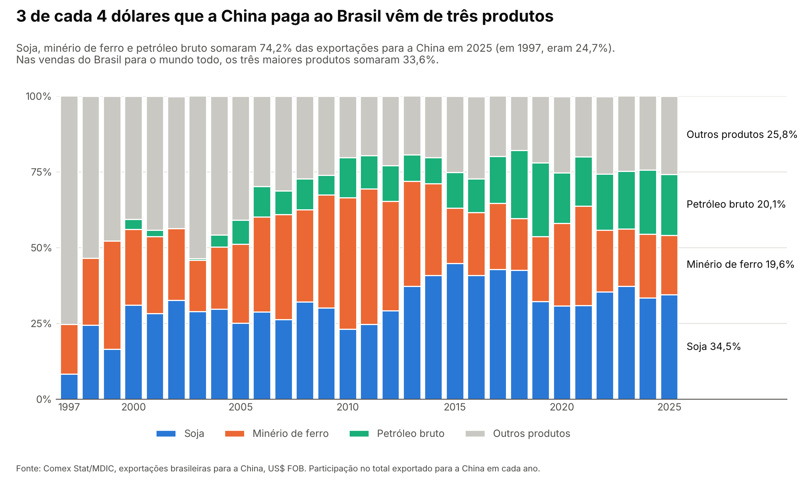

# A China compra soja do Brasil. E o que mais?

**Quase nada além de minério e petróleo. De cada 4 dólares que a China paga ao Brasil, 3 vêm desses três produtos.**

*Gráfico: participação de soja, minério de ferro, petróleo bruto e outros produtos no total exportado pelo Brasil para a China, 1997–2025, em US$ FOB. Fonte: Comex Stat/MDIC.*

---

## O que está acontecendo

A China é a maior compradora do Brasil desde 2009, quando passou os Estados Unidos. Em 2025, ela levou **US$ 99,9 bilhões** em produtos brasileiros, ou **28,7%** de tudo o que o país exportou. É mais de 2,5 vezes o que os EUA compraram (US$ 37,7 bilhões, 10,8%). Em 1997, a China era só a 12ª da lista.

O que chama atenção é *o que* ela compra. Na edição passada vimos que, em 2025, a China passou a vender mais adubo ao Brasil do que a Rússia, em toneladas. Agora, do outro lado da balança: só três produtos (**soja, petróleo bruto e minério de ferro**) somaram **74,2%** do que o Brasil vendeu à China em 2025. A **pauta exportadora**, que é a lista de produtos que um país vende lá fora, é bem mais concentrada com a China do que com o mundo. Nas vendas brasileiras para todos os países, os três maiores produtos somaram 33,6%. Em 1997, o trio era 24,7% das vendas para a China. Desde 2006, nunca ficou abaixo de 68,8% (o pico foi 82,2%, em 2018).

A mistura entre os três mudou. Por volta de 2011, o minério dominava, com 44,7% do total. Depois a soja assumiu a liderança e hoje é 34,5%, enquanto o petróleo foi de quase nada para 20,1%. E 2026 reforça a concentração: de janeiro a outubro, o Brasil vendeu US$ 93,1 bilhões à China, US$ 8,5 bilhões a mais que no mesmo período de 2025. Desse aumento, **US$ 7,9 bilhões vieram só do petróleo**.

## E a carne?

O "outros produtos" do gráfico parece parado em cerca de um quarto do total, mas em dólares ele quase triplicou: de US$ 8,8 bilhões em 2015 para **US$ 25,8 bilhões** em 2025. A maior responsável é a **carne bovina congelada**. Em 2015, o Brasil vendeu US$ 0,46 bilhão dela à China; em 2025, **US$ 8,8 bilhões**, 19 vezes mais. Hoje, de toda a carne bovina congelada que o Brasil exporta, **61%** vai para a China. Em 2015 eram 12%.

Mas a carne mostra também o outro lado de depender de um comprador só. De janeiro a outubro de 2026, as vendas dela à China caíram **17,8%**, de US$ 7,1 bilhões para US$ 5,8 bilhões. No mesmo período, a carne de frango subiu de US$ 0,5 bilhão para US$ 1,3 bilhão.

## O que isso quer dizer pro Brasil

A relação com a China é grande, mas estreita. Em 2025, o Brasil vendeu **841 produtos diferentes** para lá, e só **7 passaram de US$ 1 bilhão**. E a dependência vale nos dois sentidos dentro de cada produto: a China levou **79%** da soja que o Brasil exportou em 2025, **68%** do minério de ferro e **45%** do petróleo bruto. Ou seja, quando o preço da soja ou do minério muda, ou quando a China compra mais ou menos, uma fatia enorme das exportações brasileiras muda junto.

## 📌 Dado pra guardar

> **De cada 4 dólares que a China paga ao Brasil, 3 vêm de soja, minério de ferro e petróleo.**

---

## Fontes

- **Exportações brasileiras:** Comex Stat, Ministério do Desenvolvimento, Indústria, Comércio e Serviços (MDIC), dados abertos. Exportação, por país e por SH4 (código de 4 dígitos do Sistema Harmonizado, que agrupa produtos parecidos), em US$ FOB (valor no porto de embarque, sem frete nem seguro), de 1997 a out/2026 (carga de 06/11/2026). Soja = SH4 1201; minério de ferro = 2601; petróleo bruto = 2709; carne bovina congelada = 0202; carne de frango = 0207. [comexstat.mdic.gov.br](https://comexstat.mdic.gov.br/pt/geral) · API: [api-comexstat.mdic.gov.br](https://api-comexstat.mdic.gov.br)

*Como foi feito: os dados foram baixados da API oficial do Comex Stat. O código está aberto e qualquer pessoa pode refazer tudo.*
