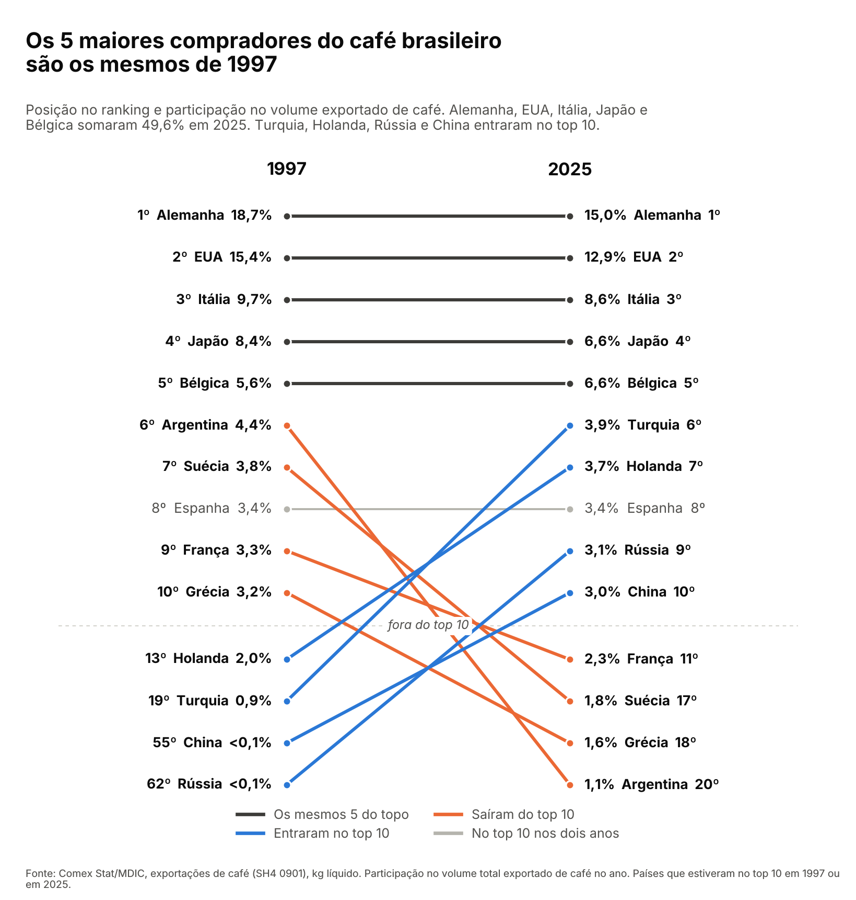

# Quem toma o café do Brasil?

**Os mesmos países de sempre. Os 5 maiores compradores do café brasileiro em 2025 são exatamente os de 1997, e os 4 primeiros estão até na mesma ordem.**

*Gráfico: posição no ranking e participação no volume de café exportado pelo Brasil, 1997 e 2025. Países que estiveram no top 10 em um dos dois anos. Fonte: Comex Stat/MDIC.*

---

## O que está acontecendo

Em 1997, os maiores compradores do café brasileiro eram, nesta ordem, **Alemanha, Estados Unidos, Itália, Japão e Bélgica**. Em 2025, a lista é idêntica. Os cinco somaram **49,6%** do volume exportado no ano passado, ou seja, quase metade do café que o país exportou foi para um deles. E o primeiro lugar nunca saiu da mão de dois: de 1997 a 2025, a Alemanha liderou em 16 anos e os EUA em 13. Em 2026, de janeiro a outubro, os americanos estão na frente.

A mudança aconteceu do 6º lugar para baixo. **Argentina, Suécia, França e Grécia saíram do top 10.** A Argentina, que era a 6ª em 1997, caiu para 20ª. No lugar delas entraram **Turquia, Holanda, Rússia e China**. A China foi do 55º lugar para o 10º; a Rússia, do 62º para o 9º. E apareceu a **Colômbia**: não estava nos registros de 1997 e em 2025 já era a 16ª compradora. No total, o café brasileiro foi vendido para **139 países** em 2025, contra 73 em 1997, e o top 10 encolheu de 75,8% para 66,8% do volume. A clientela ficou mais espalhada, mesmo com o topo parado.

## O preço mudou tudo

Se a fila de compradores mudou pouco, a conta mudou muito. Em 2025, o Brasil exportou **37,9 milhões de sacas** (a saca, unidade usual do café, tem 60 kg), 18% a menos que o recorde de 2024 (46,2 milhões). Mesmo vendendo menos, faturou **US$ 14,9 bilhões FOB** (valor no porto de embarque, sem frete nem seguro), 31% a mais que em 2024 e o maior valor desde 1997, quando começa a série do Comex Stat. A saca saiu em média a **US$ 394**, contra US$ 246 em 2024 e US$ 190 em 1997. O fundo do poço foi 2002, quando valia US$ 46. São dólares da época, sem descontar a inflação americana. Em 2026, de janeiro a outubro, o volume ficou praticamente igual ao do mesmo período de 2025 (−1,8%), e o valor caiu 8,9%, com a saca a US$ 357 em média.

## O que isso quer dizer pro Brasil

O café é o contrário do que vimos com a soja na edição passada. Lá, um comprador só (a China) leva 79% de tudo. Aqui, nenhum país passa de 15% do volume, e o café chega a 139 destinos. Mas a base continua sendo a mesma de sempre: Europa Ocidental, Estados Unidos e Japão. E a China, maior compradora do Brasil no geral, aqui é só a 10ª, com 3,0% do volume em 2025, bem longe dos 79% que leva da soja. O lugar dela no café também oscila: de janeiro a outubro de 2026, caiu para a 18ª posição.

## 📌 Dado pra guardar

> **Desde 1997, o maior comprador do café brasileiro foi sempre a Alemanha ou os Estados Unidos.**

---

## Fontes

- **Exportações de café:** Comex Stat, Ministério do Desenvolvimento, Indústria, Comércio e Serviços (MDIC), dados abertos. Exportação do SH4 0901 (café, mesmo torrado ou descafeinado; 99,6% do valor em 2025 é café cru em grão), por país, em kg líquido e US$ FOB, de 1997 a out/2026 (carga de 06/11/2026). Café solúvel fica em outro código (NCM 21011110) e não entra nas contas do texto. [comexstat.mdic.gov.br](https://comexstat.mdic.gov.br/pt/geral) · API: [api-comexstat.mdic.gov.br](https://api-comexstat.mdic.gov.br)

*Como foi feito: os dados foram baixados da API oficial do Comex Stat. O código está aberto e qualquer pessoa pode refazer tudo.*
